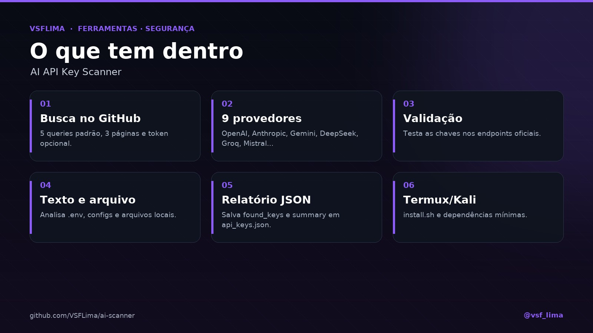

<div align="center">


# 🔑 AI API Key Scanner

**Varre o GitHub e valida chaves de API de IA — em Termux, Kali NetHunter ou desktop.**

Script Python que procura padrões de chaves de API de IA em código público, valida as chaves nos endpoints oficiais e salva um relatório JSON.


[](https://t.me/vsf_lima)


</div>

---

## 📖 Sobre

O **AI API Key Scanner** é um script standalone para **Termux/Kali NetHunter** que varre o GitHub em busca de chaves de API de IA, extrai os padrões, valida as chaves encontradas e gera `api_keys.json`. Também analisa texto colado (`.env`, configs) e arquivos locais.

Ele cobre **9 provedores**: OpenAI, DeepSeek, Anthropic, Gemini, Hugging Face, Replicate, Mistral, Groq e Cohere. O script evita duplicatas, testa as chaves nos endpoints oficiais (quando o provedor oferece um) e imprime um resumo no terminal.

Foi feito para **pentest autorizado e pesquisa de segurança**: encontra segredos expostos para que sejam **revogados e reportados** — não para usar as chaves.

## ✨ Recursos

| Módulo | O que faz |
|---|---|
| 🔎 **Busca no GitHub** | 5 queries padrão, 30 resultados por página e até 3 páginas; token opcional para elevar o rate limit. |
| 🧩 **9 provedores** | OpenAI, DeepSeek, Anthropic, Gemini, Hugging Face, Replicate, Mistral, Groq e Cohere. |
| ✅ **Validação** | Testa as chaves nos endpoints oficiais e marca o resultado de cada uma. |
| 📄 **Texto e arquivo** | Analisa conteúdo colado (`.env`, configs) ou um arquivo local. |
| 📊 **Relatório JSON** | Salva `found_keys` e `summary` em `api_keys.json`. |
| 📱 **Termux/Kali** | `install.sh` instala Python, Git, Wget e as dependências. |

## 🖼️ Prévia

<p align="center">
  
</p>
<p align="center"><em>Busca, validação e relatório de chaves de API de IA.</em></p>

## 🛠️ Stack

- **Linguagem:** Python 3
- **HTTP:** `requests` + `urllib3`
- **Fonte:** GitHub Code Search API
- **Validação:** endpoints oficiais dos provedores
- **Saída:** JSON (`api_keys.json`)
- **Ambiente:** Termux, Kali NetHunter ou desktop

## 📁 Estrutura

```text
.
├── ai_key_scanner.py   # scanner + validação + relatório
├── api_keys.json       # saída (found_keys + summary)
└── install.sh          # dependências para Termux
```

## 🚀 Instalação

```bash
git clone https://github.com/VSFLima/ai-scanner.git
cd ai-scanner
bash install.sh
# ou: pip install requests urllib3
```

## ⚙️ Uso

```bash
python3 ai_key_scanner.py
```

O menu tem três modos:

| Opção | O que faz |
|---|---|
| `1` | Buscar no GitHub com as queries padrão |
| `2` | Analisar texto colado (`.env`, config, etc.) |
| `3` | Analisar um arquivo local |

Para a busca de código no GitHub, defina um **token pessoal** em `GITHUB_TOKEN`, dentro de `main()` — o endpoint de code search exige autenticação. Os modos `2` e `3` funcionam sem token.

O resultado fica em `api_keys.json`:

```json
{
  "found_keys": [],
  "summary": {}
}
```

O script valida as chaves encontradas (quando há endpoint de validação) e imprime um resumo com quantas foram encontradas e quantas responderam como válidas.

## ⚠️ Uso responsável

- Use **somente** em repositórios e chaves que são seus ou para os quais você tem **autorização escrita**.
- Validar uma chave de terceiros é **acesso não autorizado** e pode violar os termos do GitHub e dos provedores.
- **Não use** as chaves encontradas: revogue-as, reporte ao dono do repositório/provedor e documente o achado.
- O GitHub pode bloquear a conta que faz buscas automatizadas; use token e limites baixos.
- Mantenha a ferramenta em ambiente de teste e não a deixe exposta.

## 📌 Status

Script standalone, sem suíte de testes automatizados. Feito para Termux/Kali e para uso em **pentest autorizado**. O `api_keys.json` incluído no repositório é um resultado de exemplo.

## 🤝 Contribuindo

Contribuições são bem-vindas! Leia o [`CONTRIBUTING.md`](CONTRIBUTING.md). O projeto é open source sob a licença MIT.

Para ferramentas de segurança: use apenas em alvos autorizados e **nunca** envie chaves, cookies, tokens ou achados reais em issues/PRs.

## 📄 Licença

Distribuído sob a licença **MIT**. Veja [`LICENSE`](LICENSE).

## 🙏 Créditos

- **Projeto e código:** VSFLima
- **Distribuição:** [@vsf_lima](https://t.me/vsf_lima)
- **Stack:** Python, `requests`, GitHub Code Search e APIs dos provedores

---

<p align="center">Feito por <a href="https://t.me/vsf_lima">@vsf_lima</a> — VSFLima</p>
